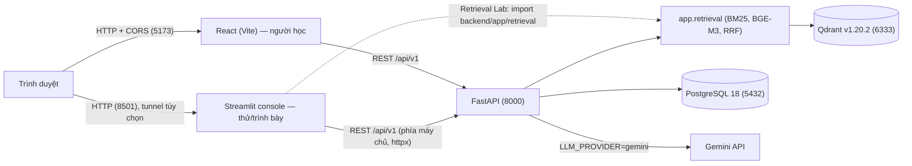

# Kiến trúc hệ thống

## Mục tiêu và phạm vi

AI Language Tutor là monorepo cho ứng dụng học tiếng Anh A1–B1, ưu tiên giao diện tiếng Việt. Tuần 1 chỉ chốt kiến trúc logic; tài liệu này không đồng nghĩa các dịch vụ hay ứng dụng đã được triển khai.

## Thành phần

| Thành phần | Công nghệ dự kiến | Trách nhiệm |
| --- | --- | --- |
| Web client | React, TypeScript, Vite, Tailwind CSS | Giao diện người học, placement, bài học, bài tập, chat và dashboard |
| API | FastAPI, Pydantic | API nghiệp vụ, xác thực đầu vào/đầu ra, điều phối học tập và RAG |
| Cơ sở dữ liệu quan hệ | PostgreSQL, SQLAlchemy, Alembic | Người dùng, hồ sơ học tập, nội dung, kết quả, lịch ôn và lịch sử chat |
| Vector store | Qdrant | Lưu và truy vấn vector tài liệu, có lọc metadata theo ngôn ngữ/cấp độ |
| Sparse retrieval | BM25 (thư viện `rank_bm25` dự kiến) | Tìm khớp từ khóa và thuật ngữ |
| Dense retrieval | BGE-M3 qua sentence-transformers/FlagEmbedding | Tìm tương đồng ngữ nghĩa đa ngôn ngữ |
| LLM | Gemini Flash qua API | Trả lời dựa trên ngữ cảnh được truy xuất và tạo giải thích |
| Dịch vụ phát triển | Docker Compose | Chạy PostgreSQL và Qdrant local khi triển khai các tuần sau |

Các phiên bản, model ID, giới hạn dịch vụ và khả năng vận hành chưa được chốt ở đây. Không có API key trong mã nguồn; cấu hình bí mật lấy từ biến môi trường hoặc `.env` không đưa vào Git.

## Luồng RAG

1. API nhận câu hỏi, `language_code`, `level_code` và chế độ truy xuất. Giá trị ngôn ngữ/cấp độ phải được kiểm tra với cấu hình và dữ liệu được phép dùng.
2. Tách truy vấn thành các dạng phù hợp cho truy vấn từ khóa và truy vấn ngữ nghĩa; giữ nguyên nội dung gốc để trả lời.
3. Chạy BM25 và dense retrieval độc lập theo cấu hình. Mỗi nhánh lọc tài liệu theo `language_code`, `level_code` và metadata phù hợp.
4. Hợp nhất thứ hạng bằng Reciprocal Rank Fusion (RRF); chọn tập ngữ cảnh trong giới hạn token.
5. Tạo prompt từ template của ngôn ngữ đích, câu hỏi, cấp độ và các đoạn trích có ID tài liệu.
6. Gọi Gemini Flash; câu trả lời chỉ được dẫn nguồn từ các tài liệu thực sự được đưa vào ngữ cảnh.
7. Trả lời cùng citations, lưu phiên chat/tin nhắn và thông tin truy xuất cần thiết để đánh giá. Khi không có ngữ cảnh đáng tin cậy, hệ thống cần nói rõ giới hạn thay vì bịa citation.

### Các chế độ đánh giá

- **LLM-only:** không truy xuất, làm baseline.
- **Dense RAG:** chỉ dense retrieval.
- **Hybrid RAG:** BM25 và dense retrieval, sau đó RRF.

Hai retriever có thể bật/tắt độc lập để chạy ablation. Cấu hình, model ID, top-k, phiên bản corpus và thời gian chạy cần được lưu cùng kết quả thực nghiệm. Tập dev dùng để điều chỉnh; test chỉ dùng cho báo cáo cuối, không dùng lặp để tối ưu.

## Quyết định kỹ thuật và lý do

| Quyết định | Lý do / đánh đổi |
| --- | --- |
| Tách web, API, PostgreSQL và Qdrant thành thành phần riêng | Ranh giới rõ, có thể kiểm thử từng tầng; đổi lại cần phối hợp cấu hình và vận hành nhiều dịch vụ |
| Dùng PostgreSQL cho dữ liệu nghiệp vụ và Qdrant cho vector | Tránh trộn giao dịch/quan hệ với truy vấn vector; metadata phải được đồng bộ có chủ đích |
| Dùng BM25 + dense + RRF | So sánh sparse/dense/hybrid theo câu hỏi nghiên cứu; RRF không cần hiệu chỉnh thang điểm giữa hai retriever |
| Giữ `language_code` và `level_code` là chuỗi mở | Cho phép mở rộng cấu hình, không khóa ngôn ngữ hay cấp độ vào enum CEFR trong schema |
| Tách cấu hình ngôn ngữ và prompt theo mã ngôn ngữ | Nội dung/messaging không bị buộc vào tiếng Anh; phần dùng chung nhận ngôn ngữ từ cấu hình |
| Lưu citation theo ID tài liệu | Có thể kiểm tra nguồn và đo citation accuracy; không chấp nhận nguồn do LLM tự tạo |
| Chạy model embedding trên CPU trước | Phù hợp môi trường dự kiến và tránh giả định có CUDA; phải đo latency/RAM trước khi quyết định thay đổi |

## Rủi ro và kiểm soát

- BGE-M3/PyTorch có thể tốn dung lượng, RAM và thời gian trên CPU; dry-run tương thích không chứng minh hiệu năng.
- Chất lượng truy vấn tiếng Việt trên corpus tiếng Anh cần được đo riêng; không xem hỗ trợ đa ngôn ngữ của model là bảo đảm chất lượng.
- LLM có thể trả lời sai hoặc dựng nguồn; ràng buộc context/citation và đánh giá faithfulness, correctness, citation accuracy.
- Quyền sử dụng tài liệu phải được ghi theo từng tài liệu; ưu tiên nội dung tự biên soạn được duyệt.
- Gemini có thay đổi model ID, quota hoặc điều khoản; cô lập qua adapter và cấu hình môi trường.
- Dữ liệu đánh giá nhỏ có thể lệch; cố định phân chia dev/test trước khi tối ưu và không tuyên bố kết quả trước khi đo.

## Ranh giới Tuần 1

Không có API nghiệp vụ, migration, tích hợp Gemini, tải model/dataset hoặc dịch vụ chạy thật trong phạm vi tài liệu kiến trúc này.

## Xác thực (Tuần 2, Buổi 3)

- Mật khẩu: Argon2id qua pwdlib (m=64 MiB, t=3, p=4; đo ~43 ms/lần trên máy dev). Tự băm lại khi tham số được nâng. Độ dài 8–128, không bắt buộc ký tự đặc biệt (NIST SP 800-63B), không trùng email.
- JWT access token HS256 (thuật toán cố định, chỉ chấp nhận HS256 khi giải mã), `sub` = user_id, có `iss`, `iat`, `exp`, `type=access`. Secret và thời hạn (mặc định 60 phút) đọc từ `.env`; app không khởi động nếu thiếu secret hoặc secret < 32 ký tự.
- Lỗi API thống nhất `{"error": {"code", "message", "details"?}}`; lỗi 422 không trả lại giá trị người dùng gửi (tránh lộ mật khẩu).

### Hạn chế đã chấp nhận (quyết định 2026-11-20)

| Hạn chế | Lý do chấp nhận | Xem lại |
| --- | --- | --- |
| Chưa có refresh token; hết 60 phút phải đăng nhập lại | Giữ phạm vi Tuần 2 | Khi có chat dài (Tuần 3+) |
| Đăng xuất chỉ xóa token phía client; token cũ còn hiệu lực đến khi hết hạn | JWT stateless, không có bảng thu hồi | Cùng lúc với refresh token |
| Đăng ký trùng email trả 409 → có thể dò email đã đăng ký | Trải nghiệm người dùng rõ ràng; chống dò triệt để cần email xác nhận | Tuần 8 |
| ~~Chưa giới hạn số lần đăng nhập sai (brute force)~~ | **Đã xử lý ở Tuần 3, Buổi 4** (theo email và IP, trong bộ nhớ) — xem mục bên dưới | Tuần 8: chuyển sang Redis nếu chạy nhiều tiến trình |

## Sơ đồ triển khai cục bộ (Tuần 5A)

- Mọi cổng dịch vụ chỉ mở trên `127.0.0.1`.
- Khi chia sẻ, **chỉ** tunnel cổng 8501 của Streamlit. Backend, PostgreSQL và Qdrant không bao giờ được tunnel.
- **Streamlit là lớp mỏng:**
  - Mọi nghiệp vụ (xác thực, giới hạn tần suất, chat/RAG, chấm placement) đi qua REST API, qua một client duy nhất `streamlit_app/api.py` (httpx, có timeout). Lỗi được ánh xạ theo `error.code` giống frontend.
  - Token chỉ nằm trong `st.session_state`, không ghi ra đĩa.
  - Ngoại lệ: Retrieval Lab import trực tiếp `app.retrieval` (cùng code với API, cache bằng `st.cache_resource`). Lỗi import hoặc Qdrant chỉ hiện hướng dẫn trên trang đó, không làm sập trang khác.
- **Chia sẻ an toàn:**
  - `STREAMLIT_ACCESS_CODE` bật cổng mã cho toàn app (so sánh `hmac.compare_digest`).
  - `STREAMLIT_PUBLIC_MODE=true` chặn chat khi backend dùng Gemini (đọc từ `GET /api/v1/system/status`) và ẩn cấu hình.
  - Nội dung do AI tạo được escape trước khi hiển thị; không dùng `unsafe_allow_html`.
- **`GET /api/v1/system/status`** (thêm ở Tuần 5A): trả nhà cung cấp LLM (fake/gemini), `RAG_MODE`, các giới hạn, trạng thái PostgreSQL và Qdrant. Không trả secret, URL hay chuỗi kết nối (có test kiểm).

## Luồng chat với gia sư AI (Tuần 3–4)

Ba chế độ trả lời: `llm_only` (Tuần 3), `dense`, `hybrid` (Tuần 4). Chế độ chọn theo từng tin (`rag_mode` trong body, đã kiểm tra hợp lệ) hoặc lấy `RAG_MODE` của máy chủ; áp dụng cùng giới hạn tần suất.

`POST /api/v1/chat/sessions/{id}/messages` (`app/api/routes/chat.py` → `app/services/chat.py::send_message`):

1. **Xác thực** (Bearer JWT) → **chủ sở hữu phiên**: phiên không tồn tại hoặc của người khác đều trả `404 chat_session_not_found` giống hệt nhau.
2. **Đầu vào**: bỏ ký tự điều khiển, tối đa `CHAT_MAX_MESSAGE_CHARS` (`422 message_too_long`).
3. **Giới hạn** (chi tiết ở mục dưới): đồng thời → phút → ngày → toàn hệ thống. Bị chặn: không lưu, không gọi LLM, trả `Retry-After`.
4. **Chuẩn bị** (`_process_turn`): đọc lịch sử gần nhất (`chat_history.build_history`: tối đa `CHAT_HISTORY_TURNS` lượt, bỏ lượt lỗi), dựng system prompt từ `prompts/<language_code>/tutor.md` với trình độ **hiện tại trong hồ sơ** (`level_code`, `level_name`). Nội dung người dùng chỉ nằm trong danh sách tin vai `user`, không ghép vào system prompt.
5. **Lưu tin người dùng và commit** trước khi gọi LLM (không giữ kết nối DB trong lúc chờ).
5b. **Truy xuất** (khi chế độ là `dense`/`hybrid`; không có transaction DB nào mở): lấy `RAG_TOP_K` tài liệu cùng `language_code` → system prompt dùng `prompts/<code>/tutor_rag.md` với khối ngữ cảnh đánh số. Lỗi hạ tầng → hạ cấp `llm_only`, `rag_fallback=true`.
6. **Gọi LLM** qua `LLMService` (`app/llm/service.py`): timeout, thử lại lỗi tạm thời có backoff, model dự phòng, chuẩn hóa lỗi thành 7 mã `llm_*`. Nhà cung cấp: `GeminiProvider` hoặc `FakeLLM` (`LLM_PROVIDER`).
7. **Kiểm tra trích dẫn rồi lưu trả lời** kèm metadata (model, token, độ trễ, `truncated`, `rag_mode`, `sources`, `citations`, `rag_fallback`); lỗi → lưu dòng trợ lý `status='error'` + `error_code`, trả lỗi theo định dạng chung `{"error": {"code", "message"}}` (không lộ thông điệp nội bộ của nhà cung cấp). Log chỉ ghi metadata (độ dài, độ trễ, token, mã lỗi), không ghi nội dung.

## RAG (Tuần 4)

Mã nguồn: `backend/app/retrieval/`. Không có mã nào hardcode tiếng Anh hay CEFR: corpus, file từ khóa và tokenizer lấy từ khối `retrieval` trong `languages/<code>.yaml`.

- **Corpus và chunk:** đọc `corpus_file` của ngôn ngữ. Mặc định 1 bài = 1 chunk (bài ≤ 160 từ, có validator kiểm). `chunk_text` tách theo câu khi bài dài hơn `max_words`.
  - `index_text` = title + topic + content. Khi `RAG_INDEX_KEYWORDS_VI=true` thì thêm `keywords_vi`; mặc định **tắt** (lý do ở `experiments/README.md`).
  - Cùng một `index_text` được dùng cho cả dense và BM25.
- **Dense** (`dense.py`): BGE-M3 (`sentence-transformers`, CPU, chuẩn hóa L2, cosine) trong Qdrant.
  - Mỗi ngôn ngữ một collection `lessons_<code>`; cấu hình có từ khóa dùng `lessons_kwvi_<code>`.
  - Collection `index_meta` lưu model, revision, số chiều và hash từng chunk.
  - `scripts/index_corpus.py` idempotent: chỉ nhúng lại chunk đổi hash và xóa chunk đã bỏ. Khi model khác thì từ chối, phải chạy lại với `--recreate`.
  - Model là singleton, tải lười (có khóa). Route chat là hàm đồng bộ nên FastAPI chạy nó trong thread pool, không chặn event loop.
- **BM25** (`bm25.py`): Okapi BM25 tự viết (k1 = 1,5; b = 0,75; IDF = ln((N − df + 0,5)/(df + 0,5) + 1)), index trong bộ nhớ theo ngôn ngữ.
  - Tokenizer (`tokenizer.py`): chuẩn hóa Unicode, chữ thường, bỏ dấu tiếng Việt (`đ` → `d`), bỏ từ dừng theo YAML.
- **Hybrid** (`hybrid.py`, `rrf.py`): mỗi nhánh lấy `RAG_CANDIDATES` ứng viên (mặc định 20), hợp nhất bằng RRF: `Σ 1/(k + rank)` với `RAG_RRF_K` (mặc định 60).
  - Chỉ dùng thứ hạng, không dùng điểm gốc. Khi hòa điểm, ưu tiên thứ hạng tốt nhất, sau đó theo id.
- **Bộ lọc:** `language_code` **bắt buộc** ở mọi nhánh (lọc trong truy vấn Qdrant và trong BM25). Lọc theo trình độ là tùy chọn (`RAG_FILTER_LEVEL`), mặc định tắt.
- **Prompt** (`prompts/<code>/tutor_rag.md`): các đoạn `[1]`, `[2]`… nằm giữa `<<<TAI_LIEU>>>` và `<<<HET_TAI_LIEU>>>`.
  - Nếu chuỗi phân cách xuất hiện trong nội dung thì bị xóa, để không đóng khối sớm.
  - Prompt nói rõ ngữ cảnh là **dữ liệu, không phải chỉ dẫn**; chỉ dùng ngữ cảnh cho kiến thức ngữ pháp; nếu không đủ thì nói rõ; trích dẫn bằng `[n]`.
  - Câu hỏi người dùng vẫn chỉ nằm trong danh sách tin nhắn.
- **Trích dẫn** (`citations.py::check_citations`, hàm thuần):
  - Chỉ giữ `[n]` với 1 ≤ n ≤ số tài liệu đã truy xuất.
  - `[n]` khác bị xóa khỏi câu trả lời và ghi vào `citations.invalid`. Hệ thống không hiển thị nguồn không có thật.
  - `sources` lưu `{n, document_id, title, level, rank, score, text, cited}`.
  - Khi gửi lịch sử cho LLM, `[n]` của các lượt cũ bị xóa vì chúng trỏ tới ngữ cảnh cũ.
- **Hạ cấp:**
  - Trong chat: Qdrant không kết nối, model không tải được, chưa có index hoặc index khác model đều được chuẩn hóa thành `RetrievalError`. Câu trả lời chuyển sang `llm_only`, đặt `rag_fallback=true`, giao diện báo "Không truy xuất được tài liệu".
  - Trong `scripts/eval_retrieval.py`: **không hạ cấp**, dừng với lỗi để tránh số liệu sai.
- **Giao diện:** ô chọn "Chế độ trả lời" cho từng tin; danh sách nguồn dưới câu trả lời (tên bài, trình độ, `
` để xem đoạn đã dùng).
  - Lưu ý "không dẫn nguồn" chỉ hiện ở `llm_only`. Ở các chế độ khác có ghi chú khi bị hạ cấp, và khi câu trả lời RAG không trích dẫn gì.
- **Log:** chỉ ghi metadata (`rag_mode`, `rag_fallback`, số nguồn, số trích dẫn hợp lệ/không hợp lệ); không ghi câu hỏi, câu trả lời hay ngữ cảnh.
- **Số đo** (dev, `experiments/README.md`): hybrid R@3 = 1,00, MRR 0,883, p95 359 ms; dense R@3 = 0,95, MRR 0,863, p95 316 ms. BGE-M3 trên CPU: p95 nhúng truy vấn ≤ 110 ms, RAM 2,1 GB.

## Giới hạn tần suất và chống lạm dụng (Tuần 3, Buổi 4)

- **Thuật toán:** cửa sổ trượt dạng nhật ký (`app/core/rate_limit.py`): đúng nghĩa "N lần trong X giây", Retry-After chính xác, bộ nhớ chặn trên (≤ `limit` mốc mỗi khóa, ≤ 10.000 khóa; dọn khóa hết hạn rồi bỏ khóa cũ nhất). An toàn đa luồng bằng `threading.Lock`. Ngưỡng cấu hình qua `.env` (`0` = tắt).
- **Đăng nhập/đăng ký:** đếm đăng nhập SAI theo email đã chuẩn hóa và theo IP (cửa sổ `AUTH_LOGIN_WINDOW_SECONDS`), đăng nhập đúng xóa bộ đếm email; đăng ký giới hạn theo IP mỗi giờ. Bị chặn → `429 auth_rate_limited` + `Retry-After`, thông điệp như nhau dù email có tồn tại hay không.
- **Chat:** thứ tự kiểm tra: chủ sở hữu phiên (404) → độ dài (422) → đồng thời (`409 chat_busy`) → phút (`429 chat_rate_limited`) và ngày theo `USER_TIMEZONE` (`429 chat_daily_limit_reached`, Retry-After đến nửa đêm) → toàn hệ thống (`429 service_busy`: tạm khóa sau 429 thật từ nhà cung cấp, ngưỡng ngày, ngưỡng phút) → lưu tin → gọi LLM. Bị từ chối vì giới hạn: không lưu tin, không gọi LLM. Khóa "đang xử lý" nhả trong `finally`.
- **Tạm khóa sau lỗi giới hạn thật** (`app/core/limits.py::llm_cooldown_seconds`): `llm_rate_limited` (theo phút) khóa theo `retry_after`, mặc định 30 giây, tối đa 60 giây; `llm_quota_exhausted` (hết hạn mức NGÀY, chỉ xảy ra sau khi đã thử cả model dự phòng) khóa `LLM_QUOTA_COOLDOWN_SECONDS` (mặc định 900, khoảng 60–3600; `0` = như theo phút) để không gọi API vô ích lặp lại.
- **`LLM_GLOBAL_PER_MINUTE` đếm request của người dùng, không đếm lời gọi thật.** Mỗi request có thể gây tối đa (1 + `LLM_MAX_RETRIES`) × số model lời gọi (thử lại chỉ khi lỗi tạm thời; model dự phòng chỉ khi model chính hết hạn mức/quá tải, và có hạn mức riêng). Điểm xuất phát khuyến nghị: `LLM_GLOBAL_PER_MINUTE = 15 ÷ (1 + LLM_MAX_RETRIES)` với 15 RPM của `gemini-3.5-flash-lite` (với `LLM_MAX_RETRIES=1` → 7). Mặc định hiện tại `10` cao hơn mức này một chút vì thử lại chỉ xảy ra khi có lỗi; nếu thấy `llm_rate_limited` thật thường xuyên thì hạ xuống 7.
- **Giới hạn ngày** đếm từ `chat_messages` (bền qua khởi động lại, không thêm bảng): tin người dùng hôm nay trừ lượt hỏng do hệ thống/nhà cung cấp và trừ lượt giả lập; lượt bị chặn vì nội dung vẫn tính.
- **Chế độ `LLM_PROVIDER=fake`:** nhà cung cấp khai báo `consumes_quota=False` → câu trả lời lưu `model_id` dạng `fake:<model>` (lỗi: `fake:`), không tính vào giới hạn ngày (mỗi người và toàn hệ thống), bỏ qua ngưỡng phút toàn hệ thống và tạm khóa sau 429. Vẫn áp dụng giới hạn phút mỗi người và khóa đồng thời (chống spam). Lý do: giới hạn ngày phản ánh đúng mức dùng hạn mức Google thật; làm giao diện với `fake` không làm hết lượt của người dùng.
- **IP client:** mặc định chỉ dùng IP kết nối, KHÔNG tin `X-Forwarded-For` (giả mạo được). `TRUSTED_PROXY_COUNT=n` (Tuần 8) lấy phần tử thứ n từ cuối chuỗi. Log chỉ ghi IP rút gọn (`a.b.c.x`) hoặc 8 ký tự đầu user_id, loại giới hạn và thời gian chờ — không email, không nội dung, không mật khẩu.
- **Đầu vào chat:** bỏ ký tự điều khiển/NUL (giữ xuống dòng, tab), chuẩn hóa xuống dòng, tối đa 100 dòng. Không lọc từ khóa kiểu "ignore instructions": chống prompt injection dựa vào cấu trúc — nội dung người dùng chỉ nằm trong danh sách tin nhắn vai `user`, không bao giờ ghép vào system prompt.

### Giới hạn đã biết

| Giới hạn | Ảnh hưởng | Xử lý |
| --- | --- | --- |
| Bộ đếm phút/IP/đồng thời/tạm khóa nằm trong bộ nhớ của **một tiến trình** | Chạy nhiều worker (`uvicorn --workers`, gunicorn) hoặc nhiều máy → mỗi tiến trình đếm riêng, ngưỡng thực tế nhân lên; khởi động lại thì mất bộ đếm phút/IP | Tuần 8: Redis nếu triển khai nhiều tiến trình. Giới hạn NGÀY đếm từ DB nên không bị ảnh hưởng |
| Kiểm tra giới hạn ngày và ghi tin không nguyên tử | Nếu `CHAT_MAX_CONCURRENT_PER_USER > 1`, vài request song song có thể vượt ngưỡng ngày một chút | Mặc định `1` nên không xảy ra |
| Khi bộ đếm vượt 10.000 khóa, khóa ít dùng nhất bị bỏ | Kẻ tấn công dùng rất nhiều IP có thể đẩy bộ đếm của IP khác ra ngoài | Chấp nhận cho môi trường đồ án; reverse proxy/WAF ở Tuần 8 |
| Kẻ khác có thể cố ý đăng nhập sai `AUTH_LOGIN_FAILS_PER_EMAIL` lần với email của người khác | Khóa đăng nhập của email đó (kể cả chủ thật) trong `AUTH_LOGIN_WINDOW_SECONDS` — tấn công từ chối dịch vụ nhắm vào một tài khoản | Chấp nhận cho đồ án. Tuần 8: khóa theo cặp email + IP thay vì chỉ email, hoặc thêm CAPTCHA sau vài lần sai |
| Tạm khóa sau hết hạn mức ngày là trong bộ nhớ, một tiến trình | Khởi động lại thì mất khóa → request kế tiếp gọi API, nhận 429 rồi khóa lại (tốn đúng 1 lời gọi) | Chấp nhận; Redis ở Tuần 8 nếu nhiều tiến trình |
| FakeLLM chỉ kiểm chứng **cấu trúc** prompt (nội dung người dùng không vào system prompt) | Không chứng minh được model thật có tuân thủ prompt khi bị tấn công (in system prompt, đổi vai) | Đánh giá an toàn với model thật ở Tuần 7 |

## Frontend: chat và placement (Tuần 3, Buổi 6)

- **Route** (React Router, bảo vệ bằng `ProtectedRoute` — chưa có token → `/login`): `/chat` (`ChatPage`), `/placement` (`PlacementPage`), cùng `/profile`, `/login`, `/register`. `AppLayout` có liên kết "Gia sư AI", "Kiểm tra đầu vào"; màn hình hẹp chỉ hiện biểu tượng (có `aria-label`).
- **Một lớp gọi API duy nhất** (`src/api/client.ts`): thêm hàm chat/placement; `ApiRequestError` có `code`, `status`, `details`, `retryAfterSeconds` (đọc header `Retry-After`). Backend phải khai báo `expose_headers=["Retry-After"]` trong CORS thì JavaScript khác origin (5173 → 8000) mới đọc được header này (sửa ở Buổi 6).
- **Logic thuần** (`src/lib/*.ts`, không phụ thuộc React; test `frontend/tests/*.test.ts` chạy bằng `npm test` = `node:test`, không thêm thư viện): `apiErrors.ts` (mã lỗi → thông điệp tiếng Việt; tách nhóm giới hạn `chat_rate_limited`/`chat_daily_limit_reached`/`chat_busy`/`service_busy`/`auth_rate_limited` khỏi nhóm `llm_*`; lỗi nào thử lại được), `time.ts` (đọc Retry-After số giây hoặc ngày HTTP, giây còn lại theo mốc kết thúc, định dạng "12 giây" / "khoảng 5 giờ 12 phút"), `chat.ts` (ẩn lượt lỗi đã thử lại, chọn phiên, đếm ký tự), `placement.ts` (nhãn loại câu, đếm câu đã trả lời, lượt hoàn thành mới nhất, quyền xác nhận).
- **Đếm ngược** (`src/hooks/useCountdown.ts`): tính theo mốc kết thúc (không trôi khi tab ẩn, cập nhật lại khi tab hiện), không rút ngắn thời gian chờ đang có, dọn timer khi rời trang. Dùng cho nút gửi chat và đăng nhập/đăng ký; nút bị khóa ghi rõ "Đợi …".
- **Chat:** tin người dùng hiện ngay (state `pending` tách khỏi lịch sử máy chủ). Lỗi `llm_*`/`internal_error`: máy chủ đã lưu tin + dòng lỗi → tải lại lịch sử; "Thử lại" gửi lại đúng nội dung và lượt lỗi cũ được ẩn (`collapseRetriedTurns`) để không hiện hai lần. Lỗi giới hạn: máy chủ không lưu → giữ tin `pending`, đếm ngược rồi cho "Thử lại". Lỗi phải sửa nội dung (`message_too_long`): trả nội dung về ô nhập. Nội dung hiển thị là văn bản thuần (`whitespace-pre-wrap`), không `dangerouslySetInnerHTML`, không render markdown. Enter gửi trừ khi đang gõ bằng bộ gõ (`isComposing`, tránh gửi nhầm với Telex/VNI). Khi đang chờ trả lời, nút đổi phiên/tạo phiên bị khóa; ngoài ra phản hồi gửi tin và lịch sử tải về chỉ được áp dụng nếu phiên của yêu cầu vẫn đang được chọn (`selectedIdRef` + `isForCurrentSession`), tránh lẫn tin giữa các phiên. Luôn hiện lưu ý "AI không dẫn nguồn" và thông báo dữ liệu gửi tới Google; `truncated` → dòng "Câu trả lời có thể bị cắt…".
- **Placement:** làm bài cả trang (30 câu ngắn: thấy toàn bộ đề, bỏ qua rồi quay lại dễ, ít thao tác). Đáp án chỉ ở state của trang. Xử lý `placement_superseded` (chuyển tới lượt mới nhất), `placement_questions_changed` (gọi lại `POST /placement/attempts`), `placement_already_submitted` (hiện kết quả), `placement_not_available`. Lưu ý không phải chứng chỉ CEFR dùng đúng chuỗi `disclaimer` của máy chủ.

## Bài kiểm tra đầu vào — placement (Tuần 3, Buổi 5)

- **Ngân hàng câu hỏi:** `data/evaluation/placement_v1.json` → bảng `questions` bằng `scripts/load_placement.py` (`--target test|main`, `--dry-run`): kiểm tra schema trước bằng validator Tuần 1 (lỗi → không ghi gì), khớp theo `external_id` (nạp lại không trùng), chỉ đọc file nguồn. Bộ câu hỏi của mỗi ngôn ngữ khai báo ở `languages/<code>.yaml` (`placement.question_set`).
- **Chấm điểm** (`app/services/placement_scoring.py`, hàm thuần): hoàn toàn phía máy chủ bằng đáp án đã duyệt, **không dùng LLM**. Trình độ = trình độ cao nhất có ngưỡng ≤ điểm phần trăm; ngưỡng đọc từ YAML (tiếng Anh: A2 ≥ 40%, B1 ≥ 70%, trạng thái *tạm thời*), so sánh bằng số nguyên để đúng ở ranh giới (12/30 = 40% → A2). Logic dùng chung không chứa mã trình độ cố định. Nhóm yếu: nhóm (trình độ × loại câu) đúng < 60%; kèm danh sách chủ đề làm sai (không chấm "yếu" theo từng chủ đề vì phần lớn chủ đề chỉ có 1 câu).
- **API** (`/api/v1/placement/attempts`): bắt đầu (câu hỏi không kèm đáp án/giải thích/trình độ/chủ đề), nộp (một lần; `SELECT ... FOR UPDATE` chống nộp đồng thời), xem kết quả (đáp án và giải thích chỉ sau khi nộp), xác nhận trình độ đề xuất (`apply` → cập nhật `current_level_code`, ghi `applied_at`; chỉ lượt hoàn thành **mới nhất** của người dùng cho ngôn ngữ đó, lượt cũ → 409 `placement_superseded`; gọi lại không lỗi). Lượt đang làm không còn khớp bộ câu hỏi bị xóa (chỉ khi `status='in_progress'`) và thay bằng lượt mới khi gọi `start`. Mỗi người một lượt đang làm cho mỗi ngôn ngữ (unique index có điều kiện), được làm lại sau khi nộp. Lượt của người khác → 404. Kết quả ghi rõ không phải chứng chỉ CEFR chính thức và ngưỡng đang tạm thời.

### Giới hạn đã biết (placement)

| Giới hạn | Ảnh hưởng | Xử lý |
| --- | --- | --- |
| Trình độ chỉ tính theo **điểm tổng** (30 câu), ngưỡng 40%/70% **tạm thời** | Độ tin cậy thấp: sai lệch ±1–2 câu đổi được trình độ; không xét điểm từng trình độ | Ghi rõ "tạm thời" trong kết quả; hiệu chuẩn bằng pilot ở Tuần 7 |
| Làm lại với **cùng 30 câu** sau khi đã xem đáp án có thể ra điểm cao | Trình độ đề xuất bị thổi phồng | Chấp nhận cho đồ án: kết quả chỉ là **đề xuất**, người dùng tự xác nhận (`apply`), chỉ lượt mới nhất được áp dụng. Giảm nhẹ sau: ngân hàng câu hỏi lớn hơn để xoay vòng đề |
| Endpoint placement **chưa có giới hạn tần suất** | Có thể bị gọi dồn (tạo/nộp lượt liên tục) | Chấp nhận: không dùng LLM nên không tốn hạn mức; mỗi người chỉ một lượt đang làm. Thêm giới hạn nếu triển khai công khai (Tuần 8) |
| Câu hỏi bị xóa/thay khỏi bảng `questions` | Lượt **đang làm** lỗi thời tự bị thay khi gọi `start` (201); xem lượt dở lỗi thời → 409 `placement_questions_changed`. Lượt **đã nộp** dùng câu bị xóa cũng không xem lại chi tiết được (409) dù điểm/trình độ vẫn còn trong `answer_summary` | Không xóa câu hỏi đã dùng; khi đổi đề, tạo `question_set` mới (ví dụ `placement_v2`) thay vì sửa/xóa bộ cũ |
