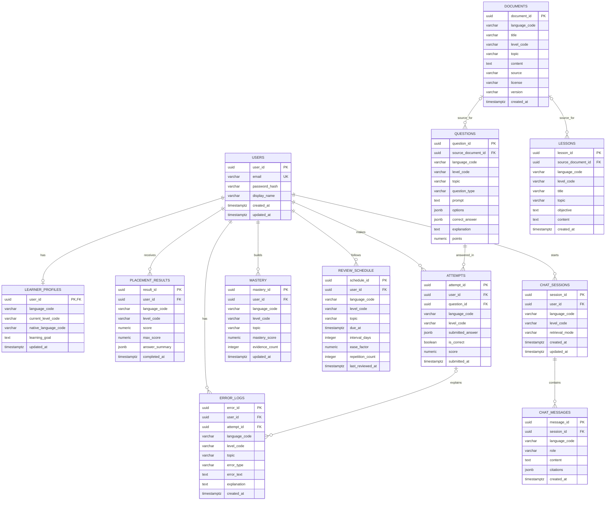

# Thiết kế cơ sở dữ liệu (logic)

## Quy ước

- Hệ quản trị dự kiến: PostgreSQL.
- Khóa chính dùng UUID; thời gian dùng `TIMESTAMPTZ`; đối tượng có cấu trúc linh hoạt dùng `JSONB`.
- `language_code` là `VARCHAR`, mặc định `'en'` trên các bảng dữ liệu học và nội dung có ngôn ngữ. Mã ngôn ngữ không phải enum.
- `level_code` là `VARCHAR`, không phải enum CEFR; các mã như `A1`, `A2`, `B1` là giá trị cấu hình, không phải kiểu dữ liệu đóng.
- Sơ đồ và kiểu dưới đây là thiết kế logic, chưa phải DDL triển khai. Chưa tạo/chạy migration.
- Mọi khóa ngoại người học cần ràng buộc quyền truy cập theo `user_id` ở tầng API; không dựa vào ID do client gửi.

## ER diagram

`DOCUMENTS` có thể được tham chiếu bởi nhiều lesson/question; quan hệ này là nguồn tham khảo tùy chọn, không thay thế citations của từng câu trả lời RAG. Một message thuộc đúng một chat session.

## Định nghĩa bảng

| Bảng | Cột chính và quy tắc |
| --- | --- |
| `users` | `user_id` PK; `email` bắt buộc, unique và chuẩn hóa trước khi lưu; `password_hash` không bao giờ lưu mật khẩu rõ; thời gian tạo/cập nhật. Bảng tài khoản, không có `level_code`. |
| `learner_profiles` | `user_id` PK/FK → users (1:1); `language_code VARCHAR NOT NULL DEFAULT 'en'` là ngôn ngữ đang học; `current_level_code VARCHAR NOT NULL DEFAULT 'A1'`; `native_language_code VARCHAR NOT NULL DEFAULT 'vi'`; `learning_goal TEXT NULL` là mục tiêu học tập do người học tự nhập (bổ sung 2026-11-18, đã duyệt). |
| `documents` | `document_id` PK; `language_code` mặc định `en`; `level_code` VARCHAR; `title`, `topic`, `content`, `source`, `license`, `version` bắt buộc cho corpus đã duyệt. Tách `language_code` khỏi tên hiển thị ngôn ngữ. |
| `lessons` | `lesson_id` PK; `language_code` mặc định `en`; `level_code` VARCHAR; `title`, `topic`, `objective`, `content`; `source_document_id` nullable FK → documents. |
| `questions` | `question_id` PK; `language_code` mặc định `en`; `level_code` VARCHAR; `topic`, `question_type`, `prompt`, `correct_answer`, `explanation`, `points`; `options` JSONB; `source_document_id` nullable FK. Đáp án đúng chỉ được trả cho client qua luồng chấm phù hợp. |
| `placement_results` | `result_id` PK; FK `user_id`; `language_code` mặc định `en`; `level_code` VARCHAR là cấp được xếp; `score`, `max_score`, `answer_summary` JSONB, `completed_at`. Mỗi lần làm tạo một kết quả mới. |
| `attempts` | `attempt_id` PK; FK đến user/question; `language_code` mặc định `en`; `level_code` VARCHAR; `submitted_answer` JSONB, `is_correct`, `score`, `submitted_at`. Lưu lịch sử thay vì ghi đè lần làm trước. |
| `error_logs` | `error_id` PK; FK user; `attempt_id` nullable FK → attempts; `language_code` mặc định `en`; `level_code` VARCHAR; `topic`, `error_type`, `error_text`, `explanation`, `created_at`. |
| `mastery` | `mastery_id` PK; FK user; `language_code` mặc định `en`; `level_code` VARCHAR; `topic`, `mastery_score`, `evidence_count`, `updated_at`. Unique `(user_id, language_code, level_code, topic)`. |
| `review_schedule` | `schedule_id` PK; FK user; `language_code` mặc định `en`; `level_code` VARCHAR; `topic`, `due_at`, `interval_days`, `ease_factor`, `repetition_count`, `last_reviewed_at`. Unique `(user_id, language_code, level_code, topic)` cho một lịch ôn hiện hành mỗi chủ đề. |
| `chat_sessions` | `session_id` PK; FK user; `language_code` mặc định `en`; `level_code` nullable VARCHAR; `retrieval_mode` VARCHAR (ví dụ `llm_only`, `dense`, `hybrid`); `created_at`, `updated_at`. |
| `chat_messages` | `message_id` PK; FK session; `language_code` mặc định `en`; `role` VARCHAR; `content`, `citations` JSONB, `created_at`. Citation cần có ID tài liệu và đoạn được dùng; không chấp nhận URL/source tự sinh như nguồn xác thực. |

## Chỉ mục và toàn vẹn dữ liệu

- Unique index trên `users.email` sau chuẩn hóa.
- Index phục vụ lọc corpus: `documents(language_code, level_code, topic)`; các bảng lesson/question cũng cần index theo `(language_code, level_code, topic)`.
- Index lịch sử theo user/thời gian: `placement_results(user_id, completed_at DESC)`, `attempts(user_id, submitted_at DESC)`, `chat_sessions(user_id, updated_at DESC)`, `chat_messages(session_id, created_at)`.
- Index lịch nhắc theo `review_schedule(user_id, due_at)`.
- Kiểm tra `score >= 0`, `max_score > 0`, `mastery_score` nằm trong miền quy ước, `interval_days >= 0`; miền điểm mastery cần được chốt trước migration.
- Xóa tài khoản/cascade, retention, versioning nội dung và lưu trữ dữ liệu cá nhân cần được quyết định trước khi migration. Không tự chọn cascade có thể xóa lịch sử học.
- `language_code`/`level_code` cần được kiểm tra ở tầng ứng dụng với cấu hình đã nạp; không dùng enum DB để đóng danh sách.

## Chưa quyết định

Trạng thái duyệt: **ERD logic đã được người dùng (người quản lý dự án) xác nhận duyệt ngày 2026-11-18.** Duyệt ERD logic chưa đồng nghĩa sẵn sàng migration. Trước khi chuyển thành migration phải chốt các quyết định còn mở gồm chính sách xóa tài khoản/dữ liệu, lưu đáp án placement chi tiết hay chỉ summary, cấu trúc citations, miền `mastery_score`, và việc tách bảng tài liệu–đoạn (chunks) cho vector index.
