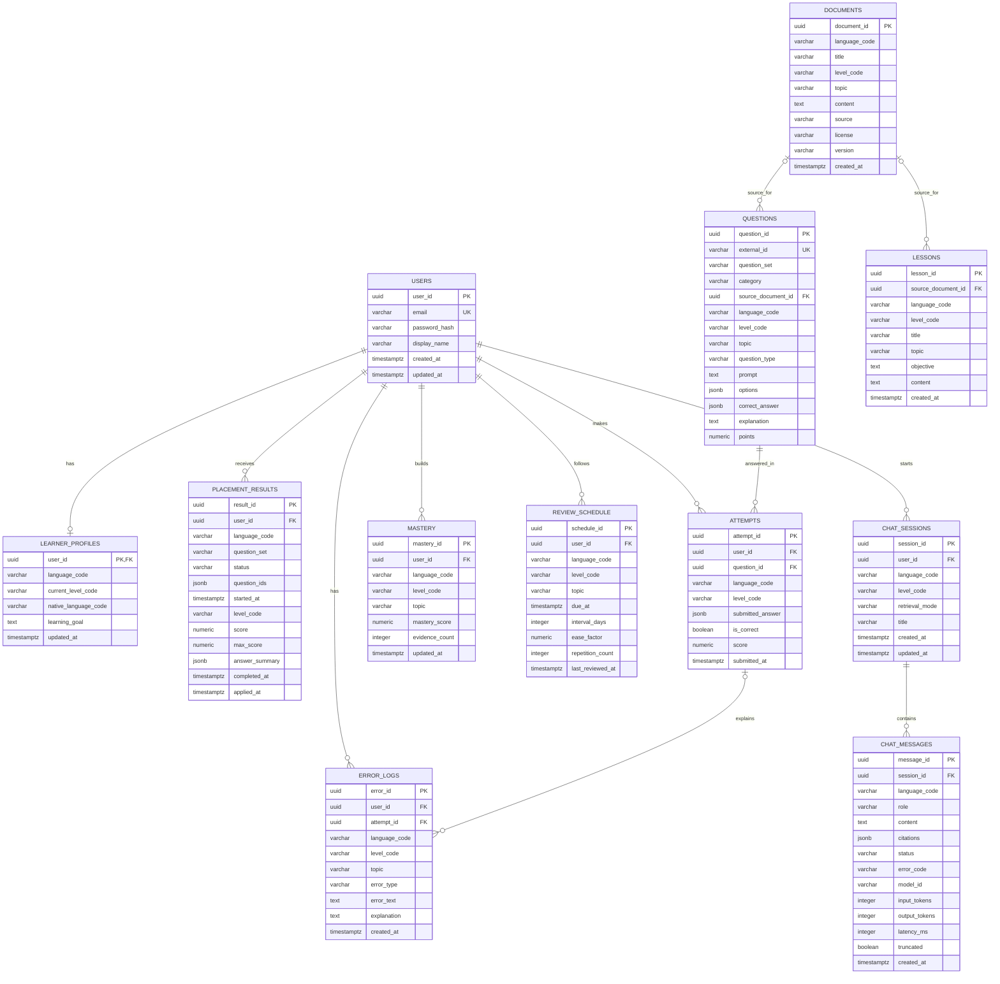
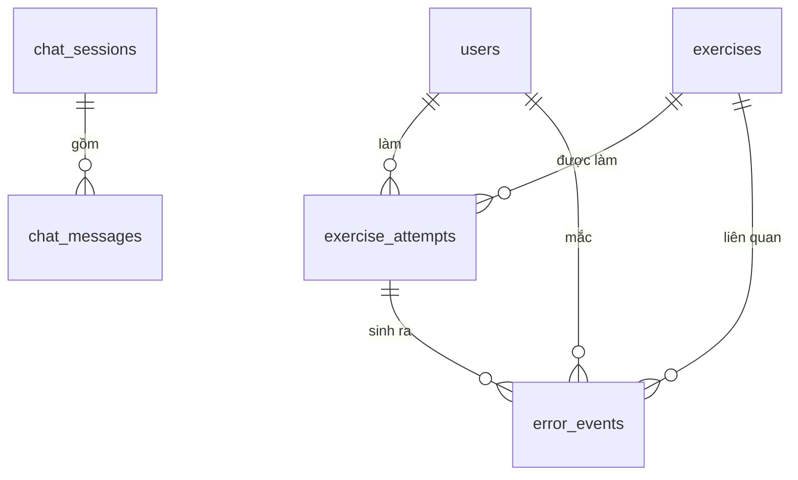

# Thiết kế cơ sở dữ liệu (logic)

## Quy ước

- Hệ quản trị dự kiến: PostgreSQL.
- Khóa chính dùng UUID; thời gian dùng `TIMESTAMPTZ`; đối tượng có cấu trúc linh hoạt dùng `JSONB`.
- `language_code` là `VARCHAR`, mặc định `'en'` trên các bảng dữ liệu học và nội dung có ngôn ngữ. Mã ngôn ngữ không phải enum.
- `level_code` là `VARCHAR`, không phải enum CEFR; các mã như `A1`, `A2`, `B1` là giá trị cấu hình, không phải kiểu dữ liệu đóng.
- Sơ đồ và kiểu dưới đây là thiết kế logic, chưa phải DDL triển khai. Chưa tạo/chạy migration.
- Mọi khóa ngoại người học cần ràng buộc quyền truy cập theo `user_id` ở tầng API; không dựa vào ID do client gửi.

## ER diagram

`DOCUMENTS` có thể được tham chiếu bởi nhiều lesson/question; quan hệ này là nguồn tham khảo tùy chọn, không thay thế citations của từng câu trả lời RAG. Một message thuộc đúng một chat session.

## Định nghĩa bảng

| Bảng | Cột chính và quy tắc |
| --- | --- |
| `users` | `user_id` PK; `email` bắt buộc, unique và chuẩn hóa trước khi lưu; `password_hash` không bao giờ lưu mật khẩu rõ; thời gian tạo/cập nhật. Bảng tài khoản, không có `level_code`. |
| `learner_profiles` | `user_id` PK/FK → users (1:1); `language_code VARCHAR NOT NULL DEFAULT 'en'` là ngôn ngữ đang học; `current_level_code VARCHAR NOT NULL DEFAULT 'A1'`; `native_language_code VARCHAR NOT NULL DEFAULT 'vi'`; `learning_goal TEXT NULL` là mục tiêu học tập do người học tự nhập (bổ sung 2026-11-18, đã duyệt). |
| `documents` | `document_id` PK; `language_code` mặc định `en`; `level_code` VARCHAR; `title`, `topic`, `content`, `source`, `license`, `version` bắt buộc cho corpus đã duyệt. Tách `language_code` khỏi tên hiển thị ngôn ngữ. |
| `lessons` | `lesson_id` PK; `language_code` mặc định `en`; `level_code` VARCHAR; `title`, `topic`, `objective`, `content`; `source_document_id` nullable FK → documents. |
| `questions` | `question_id` PK; `language_code` mặc định `en`; `level_code` VARCHAR; `topic`, `question_type`, `prompt`, `correct_answer`, `explanation`, `points`; `options` JSONB; `source_document_id` nullable FK. Đáp án đúng chỉ được trả cho client qua luồng chấm phù hợp. Bổ sung đã duyệt (Tuần 3): `external_id` VARCHAR(64) UNIQUE (ID trong file nguồn, nạp lại không trùng), `question_set` (ví dụ `placement_v1`), `category`; `question_type` mặc định `multiple_choice`. **Chưa có** `source_document_id` (bảng `documents` chưa tồn tại — thêm khi làm corpus). Index `(question_set, language_code, level_code, topic)`. Nạp bằng `scripts/load_placement.py`. |
| `placement_results` | `result_id` PK; FK `user_id`; `language_code` mặc định `en`; `level_code` VARCHAR là cấp được xếp; `score`, `max_score`, `answer_summary` JSONB, `completed_at`. Mỗi lần làm tạo một kết quả mới. Bổ sung đã duyệt (Tuần 3): `question_set`, `status` (`in_progress`/`completed`), `question_ids` JSONB (thứ tự đề), `started_at` (`clock_timestamp()`), `applied_at` (lúc người dùng xác nhận dùng trình độ đề xuất); `completed_at`, `level_code`, `score`, `max_score`, `answer_summary` NULL khi đang làm. CHECK: `completed` phải có đủ kết quả; `applied_at` chỉ khi `completed`. Unique index có điều kiện `(user_id, language_code) WHERE status='in_progress'` (mỗi người một lượt đang làm). `level_code` là trình độ ĐỀ XUẤT. Migration `dfd85f565969`. |
| `attempts` | `attempt_id` PK; FK đến user/question; `language_code` mặc định `en`; `level_code` VARCHAR; `submitted_answer` JSONB, `is_correct`, `score`, `submitted_at`. Lưu lịch sử thay vì ghi đè lần làm trước. |
| `error_logs` | `error_id` PK; FK user; `attempt_id` nullable FK → attempts; `language_code` mặc định `en`; `level_code` VARCHAR; `topic`, `error_type`, `error_text`, `explanation`, `created_at`. |
| `mastery` | `mastery_id` PK; FK user; `language_code` mặc định `en`; `level_code` VARCHAR; `topic`, `mastery_score`, `evidence_count`, `updated_at`. Unique `(user_id, language_code, level_code, topic)`. |
| `review_schedule` | `schedule_id` PK; FK user; `language_code` mặc định `en`; `level_code` VARCHAR; `topic`, `due_at`, `interval_days`, `ease_factor`, `repetition_count`, `last_reviewed_at`. Unique `(user_id, language_code, level_code, topic)` cho một lịch ôn hiện hành mỗi chủ đề. |
| `chat_sessions` | `session_id` PK; FK user; `language_code` mặc định `en`; `level_code` nullable VARCHAR; `retrieval_mode` VARCHAR (ví dụ `llm_only`, `dense`, `hybrid`); `created_at`, `updated_at`. Bổ sung đã duyệt (Tuần 3): `title` VARCHAR(120) nullable (lấy từ tin đầu tiên). Index `(user_id, updated_at DESC)`. |
| `chat_messages` | `message_id` PK; FK session; `language_code` mặc định `en`; `role` VARCHAR; `content`, `citations` JSONB, `created_at`. Citation cần có ID tài liệu và đoạn được dùng; không chấp nhận URL/source tự sinh như nguồn xác thực. Bổ sung đã duyệt (Tuần 3, 2026-11-23): `status` (`ok`/`error`), `error_code` (bắt buộc khi `error`), `model_id`, `input_tokens`, `output_tokens`, `latency_ms`, `truncated` (trả lời bị cắt vì chạm giới hạn token). CHECK `role IN ('user','assistant')`. Index `(session_id, created_at)`. `created_at` dùng `clock_timestamp()` để giữ thứ tự trong cùng transaction. FK `RESTRICT` (chính sách xóa chưa chốt). Migration `694e39a25fe6`. |

## Chỉ mục và toàn vẹn dữ liệu

- Unique index trên `users.email` sau chuẩn hóa.
- Index phục vụ lọc corpus: `documents(language_code, level_code, topic)`; các bảng lesson/question cũng cần index theo `(language_code, level_code, topic)`.
- Index lịch sử theo user/thời gian: `placement_results(user_id, completed_at DESC)`, `attempts(user_id, submitted_at DESC)`, `chat_sessions(user_id, updated_at DESC)`, `chat_messages(session_id, created_at)`.
- Index lịch nhắc theo `review_schedule(user_id, due_at)`.
- Kiểm tra `score >= 0`, `max_score > 0`, `mastery_score` nằm trong miền quy ước, `interval_days >= 0`; miền điểm mastery cần được chốt trước migration.
- Xóa tài khoản/cascade, retention, versioning nội dung và lưu trữ dữ liệu cá nhân cần được quyết định trước khi migration. Không tự chọn cascade có thể xóa lịch sử học.
- `language_code`/`level_code` cần được kiểm tra ở tầng ứng dụng với cấu hình đã nạp; không dùng enum DB để đóng danh sách.

## Chưa quyết định

Trạng thái duyệt: **ERD logic đã được người dùng (người quản lý dự án) xác nhận duyệt ngày 2026-11-18.** Duyệt ERD logic chưa đồng nghĩa sẵn sàng migration. Trước khi chuyển thành migration phải chốt các quyết định còn mở gồm chính sách xóa tài khoản/dữ liệu, cấu trúc citations, miền `mastery_score`, và việc tách bảng tài liệu–đoạn (chunks) cho vector index.

**Đã chốt (Tuần 3, Buổi 5):** `placement_results.answer_summary` lưu **chi tiết từng câu** (`question_id`, `selected`, `is_correct`) kèm nhóm (trình độ × loại), chủ đề cần ôn, ngưỡng đã dùng và trạng thái ngưỡng. Lý do: cần để hiển thị lại kết quả/đáp án sau khi nộp, tính nhóm yếu, và hiệu chuẩn ngưỡng sau này; dữ liệu nhỏ (30 câu).

## Cập nhật Tuần 4–5B (migration `a4c9e2f17b30`, `f5bf4a121058`)

**`chat_messages`, thêm cột:**
- Tuần 4: `rag_mode` (chế độ thực sự dùng), `sources` JSONB (tài liệu đã truy xuất), `rag_fallback` (đã hạ cấp về llm_only); `citations` JSONB `{valid, invalid}`.
- Tuần 5B: `rag_low_confidence` (bật khi `RAG_MIN_CONFIDENCE` không đạt).

**`exercises`** (mọi bảng mới đều có `language_code`):

| Cột | Nội dung |
|---|---|
| `exercise_id` | PK |
| `level_code`, `exercise_type` | mcq, cloze, error_correction, reorder, translate_vi_en |
| `document_id`, `source_document_ids` JSONB, `topic`, `error_type` | `error_type` thuộc taxonomy |
| `prompt_payload` JSONB | Đề, công khai |
| `answer_key` JSONB | **Chỉ phía máy chủ, không bao giờ trả trước khi nộp** |
| `explanation` | Giải thích |
| `generation_meta` JSONB | model_id, prompt_version, rag_mode, thời gian, independent_check |
| `content_hash` | Khử trùng lặp; **UNIQUE (`language_code`, `content_hash`)** |
| `validation_status` | draft \| validated \| rejected |
| `reject_reasons` JSONB | Lý do loại |
| `review_status` | unreviewed \| approved \| rejected_by_human |
| `reviewer`, `reviewed_at`, `created_at` | |

Index `(language_code, validation_status, document_id, exercise_type)`. Bài bị loại vẫn được lưu kèm lý do: đây là dữ liệu đo chất lượng.

**`exercise_attempts`:**

| Cột | Nội dung |
|---|---|
| `attempt_id` | PK |
| `user_id` FK, `exercise_id` FK, `language_code` | |
| `answer` JSONB `{text}` | |
| `is_correct`, `score` | |
| `graded_by` | rule \| llm \| pending |
| `grading_status` | graded \| pending |
| `feedback` JSONB | verdict, errors, feedback_vi |
| `error_types` JSONB | |
| `latency_ms`, `created_at` | |

- Index `(user_id, created_at)`.
- Bài làm cần LLM chấm được lưu `pending` **trước** khi gọi LLM, nên không bị mất khi LLM lỗi; `POST …/regrade` chấm lại, idempotent.

**`error_events`:**

| Cột | Nội dung |
|---|---|
| `event_id` | PK |
| `user_id` FK, `language_code` | |
| `error_type` | Thuộc taxonomy |
| `document_id`, `exercise_id` FK, `attempt_id` FK | |
| `created_at` | |

- Index `(user_id, created_at)`.
- Dữ liệu đầu vào cho cá nhân hóa ở Tuần 6.

Khóa ngoại dùng `RESTRICT`, giống các bảng cũ; chính sách xóa dữ liệu vẫn chưa chốt.
